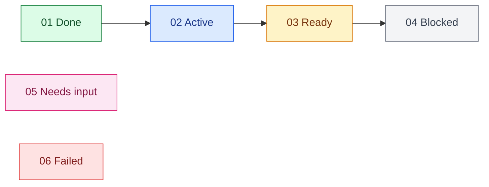

# Complete Ticket Map

Act as a control tower. Keep implementation detail in worker tasks; keep this task to decisions, state, and exceptions.

## 1. Select the run

If the invocation does not identify a project and ticket set, ask one short question: “What project and ticket set should I run?” Accept a directory, glob, issue-tracker query, planning document, or existing task links. Do not ask again when the answer is discoverable from the current workspace or prompt.

Read the repository’s agent instructions and issue-tracker convention. Discover the selected tickets, their status, dependencies, acceptance criteria, branch assignment, and any existing implementation tasks. Treat ticket files and Git as authoritative; use planning prose only to fill gaps.

Complete this step when every selected ticket has a stable ID, status, dependency list, and source location, or when one concise question is required to resolve an ambiguity that would change execution.

## 2. Build the control graph

Validate that dependencies exist and the graph is acyclic. Derive these states:

- `done`: closed and integrated
- `active`: worker currently owns it
- `ready`: open with every dependency done
- `blocked`: waiting on dependencies
- `attention`: needs a user decision or external authority
- `failed`: worker stopped after in-scope recovery attempts

Render a Mermaid graph before dispatch. Use this palette every time:

Use safe Mermaid node IDs distinct from ticket labels. Label edges only when the dependency meaning is not obvious. For more than 30 tickets, render phase/subgraph summaries plus the active frontier instead of a wall of nodes.

Complete this step when the displayed graph accounts for every selected ticket and its execution state.

## 3. Choose safe concurrency

Adopt existing worker tasks that clearly own selected tickets. Prevent duplicate ownership.

Run ready tickets in parallel only when each worker has an isolated worktree and ticket branch, the branches start from the same current integration point, and the tickets do not require concurrent mutation of a shared external resource. Otherwise run the smallest dependency-first sequence on one branch. Preserve user-owned changes.

For parallel work, integrate completed ticket branches into the integration branch before dispatching their dependents. Resolve ordinary in-scope conflicts; ask before discarding work or changing the intended architecture.

Complete this step when every active ticket has exactly one worker and concurrent workers cannot overwrite one another.

## 4. Dispatch workers

Create one user-visible Codex task per ticket. Give each worker only the ticket source, repository location, branch/worktree, dependency commits, and this completion contract:

1. Follow repository instructions and the ticket’s acceptance criteria.
2. Preserve unrelated changes and keep the diff scoped.
3. Implement the smallest root-cause solution.
4. Run focused checks plus repository-required tests, lint, typecheck, or build.
5. Review the scoped diff against repository standards and the ticket specification.
6. Commit the ticket scope, record verification evidence, and close the ticket according to its tracker convention.
7. Return at most eight short lines: result, commit, tests, review, ticket state, changed files, known pre-existing failures, and attention needed.

Tell workers to request user input only for a decision they cannot safely infer. Dispatch every safely parallel ready ticket up to available task capacity.

Complete this step when each ready ticket is active or has a recorded reason it could not be dispatched.

## 5. Run the control loop

Wait on active tasks using compact task snapshots. Prefer cursors and bounded waits. Read full task history or raw command output only when a worker requests attention, fails, or reports evidence too vague to verify.

On a worker result:

1. Verify the claimed commit, ticket state, and checks from the repository and concise handoff.
2. Integrate the branch when isolation was used; run the smallest integration check that can catch cross-ticket breakage.
3. Recompute the graph from authoritative state.
4. Dispatch newly ready tickets.

Post a colored map only after a meaningful state transition: dispatch, completion, failure, attention request, or newly unblocked frontier. Do not narrate unchanged waits. Keep prose beside each map to three short bullets: completed, active, and attention.

Complete the loop when every selected ticket is `done`, or progress requires a user decision. Continue automatically after recoverable worker failures by retrying only the failed ticket with the failure evidence.

## 6. Finish or hand off

At full completion, show the final colored map and report integrated branch, ticket count, verification result, and any pre-existing failures. At an attention boundary, show the current map, state the exact blocked decision in one question, and preserve all completed work.

The run is complete only when every selected ticket is closed, integrated, and covered by the required verification—not merely implemented in an unmerged worker branch.
